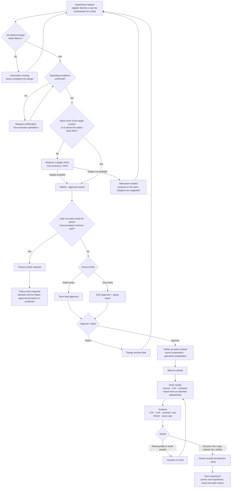

# Project K — Overseas Market A/B Experiment Operations

Project K is a small web system for marketing teams that test country or channel expansion with **small A/B experiments**. It takes an experiment from request to closure in one flow: register → get the required confirmations → route the approval → record results after launch → analyze → report.

It does not look at marketing metrics alone. Each experiment is also checked against **finance (cash constraint)**, **inventory and supply (safety stock)** and **operating conditions (shipping, customs)**. The system never approves, expands or stops an experiment on its own; people decide.

> **Read this first**
> - **No data is included.** The app will not start until you supply your own files in the format described in [3. Preparing your data](#3-preparing-your-data).
> - All decisions are **rule-based**. No LLM is connected (only a connection point exists).
> - **There is no user authentication.** Picking a role on screen is for demonstration only. Do not expose the app publicly with real data.
> - Approvals, replies and launches are **simulated inputs** entered on screen. Nothing is sent to external systems: no orders, payments or messages.
> - The user interface and generated PDF reports are in **Korean**.

---

## 1. Workflow



**Changes trigger re-evaluation.** If the design (budget, cash-out date, product) changes after approval, if finance conditions change, or if a supply reply is corrected to "not available", the approval is suspended and the route is evaluated again.

Each step creates and closes **tasks** for the responsible role (approval → launch preparation and operations preparation; start → enter results; analysis → owner decision). Who did what and when is kept in the experiment history and the audit log.

---

## 2. Quick start

Python 3.12.

```bash
pip install -r "Project K/requirements.txt"      # the psycopg line is only needed for PostgreSQL

export PROJECTK_DATA_ROOT=/path/to/my-data        # PowerShell: $env:PROJECTK_DATA_ROOT = 'C:\path\to\my-data'
python -m uvicorn app.server:app --app-dir "Project K" --port 8765
```

Open `http://127.0.0.1:8765`.

| Environment variable | Meaning | Default |
|---|---|---|
| `PROJECTK_DATA_ROOT` | Folder that holds your source data | `data_root` in the config file |
| `PROJECTK_DB` | State database file (SQLite) | `Project K/var/masil_w06.db` |
| `DATABASE_URL` | If set (and `PROJECTK_DB` is not), PostgreSQL is used | none |
| `PROJECTK_FONT`, `PROJECTK_FONT_BOLD` | Korean `.ttf` fonts for PDF reports | Malgun Gothic on Windows |
| `PROJECTK_CONFIG` | Config file path | `Project K/config/masil_w06.json` |

A `Dockerfile` is provided (listens on `PORT`, installs the Nanum Gothic font). Put your data folder in the image or mount it as a volume and point `PROJECTK_DATA_ROOT` at it.

---

## 3. Preparing your data

Place the following files under `PROJECTK_DATA_ROOT`, using the **same relative paths and column names**.

- CSV files are **UTF-8, header in the first row, pipe (`|`) delimited**. Not comma.
- Amounts are in KRW excluding VAT. Quantities are in units (EA).
- Write `NONE` for "not applicable". It is treated differently from 0 or an empty cell.
- Dates are `YYYY-MM-DD`.

### Marketing (baselines for experiments)

| File | Required columns |
|---|---|
| `02_masil/marketing/mkt_orders_ms.csv` | `order_id`, `order_date`, `customer_ref`, `channel_id`, `country`, `sku_id`, `campaign_id`, `gmv_krw` (after coupons), `coupon_discount_krw` |
| `02_masil/marketing/mkt_returns_ms.csv` | `return_id`, `order_id`, `refund_completed_date`, `original_order_date`, `refund_amount_krw`, `reason` |
| `02_masil/marketing/mkt_coupons_ms.csv` | `coupon_use_id`, `order_id`, `coupon_id`, `discount_krw`, `stacked_flag` |
| `02_masil/marketing/mkt_ad_spend_ms.csv` | `spend_id`, `campaign_id`, `spend_date`, `media`, `platform`, `sns_format`, `ad_cost_krw`, `influencer_fee_krw` |
| `02_masil/marketing/mkt_repurchase_ms.csv` | `customer_ref`, `first_order_date`, `reorder_date`, `reorder_within_90d` (True/False) |
| `02_masil/marketing/mkt_cost_master_ms.csv` | `sku_id`, `channel_id`, `product_cost_krw`, `channel_fee_pct`, `shipping_cost_krw`, `return_logistics_cost_krw` |
| `02_masil/marketing/mkt_budget_plan_ms.csv` | `plan_id`, `campaign_id`, `requested_budget_krw`, `expected_gmv_krw`, `settlement_date`, `contract_deadline` |
| `02_masil/master/m_campaign_ms.csv` | `campaign_id`, `campaign_name`, `influencer_id`, `country`, `sns_channel`, `sns_format`, `sales_channel`, `product_line`, `start_date`, `end_date`, `attribution_window_days` |
| `02_masil/master/m_channel_ms.csv` | `channel_id`, `channel_name`, `channel_type`, `partner_code`, `country`, `payment_terms_days`, `effective_date` |

### Finance (cash constraint and approval routing)

| File | Required columns |
|---|---|
| `02_masil/financials/fin_cash_daily_ms.csv` | `date`, `opening_balance`, `inflow_krw`, `outflow_krw`, `closing_balance`, `covenant_min_krw`, `breach_flag` |
| `02_masil/financials/fin_cash_forecast_ms.csv` | `forecast_date`, `week`, `projected_inflow_krw`, `projected_outflow_krw`, `projected_closing_krw` |
| `02_masil/financials/fin_ar_aging_ms.csv` | `ar_id`, `channel_id`, `invoice_date`, `due_date`, `amount_krw`, `outstanding_krw`, `aging_days` |
| `02_masil/financials/fin_ap_aging_ms.csv` | `ap_id`, `supplier_id`, `po_id` (`NONE` if none), `invoice_date`, `payment_due_date`, `amount_krw`, `aging_days` |
| `02_masil/inventory/sc_purchase_orders_ms.csv` | `po_id`, `sku_id`, `supplier_id`, `order_date`, `order_qty`, `moq`, `lead_time_weeks`, `amount_krw`, `payment_due_date` |

### Inventory and supply (supply check for the target product)

| File | Required columns |
|---|---|
| `02_masil/inventory/sku_inventory_ms.csv` | `sku_id`, `snapshot_date`, `on_hand_qty`, `in_transit_qty`, `stock_cover_weeks` |
| `02_masil/inventory/sku_weekly_sales_ms.csv` | `week`, `sku_id`, `sold_qty` |
| `02_masil/master/m_sku_ms.csv` | `sku_id`, `sku_name`, `category`, `product_id`, `source_company`, `safety_stock_weeks_min`, `safety_stock_weeks_max`, `moq`, `lead_time_weeks` |

### Documents (search and evidence)

Place the markdown documents listed under `documents` in `config/masil_w06.json` (approval policy, calculation definitions, data dictionary, meeting notes, loan covenant terms and so on) at the same paths, or edit the list to point at your own documents.

### Settings to adapt (`Project K/config/masil_w06.json`)

| Key | Meaning |
|---|---|
| `as_of` | Business reference date. This is the system's "today"; the computer clock is not used |
| `countries` | Countries you run experiments in |
| `datasets`, `documents` | Paths and access class (`internal` / `finance`) of the files to read |
| `finance.covenant_min_krw` | Minimum cash threshold |
| `approval_rules` | Per-item limit, total-proposal limit and the approver for each case |
| `experiment_defaults` | Minimum orders per arm and significance level |
| `users`, `policy.roles` | Roles and what each role may do |

Calculation assumptions (for example, product cost applied as one unit per order) are listed in `Project K/data_ext/assumptions.csv` with an ID, effective date, source and reason. Edit them to match your own basis and keep the reasons.

Two optional files in `Project K/data_ext/` ship with headers only: `preliminary_received.csv` (figures handed to you that you want re-checked against the source) and `received_window.csv` (a below-minimum-cash period you were told, compared against the recomputed one).

> File and column names are fixed. Column-level mapping is not implemented.

---

## 4. Screens

| Tab | What it shows |
|---|---|
| **Home (홈)** | Tasks to handle (your role's items first), experiment status, cash constraint (official forecast vs. recomputed forecast), country baselines |
| **Work (업무)** | A board. Columns: awaiting approval or confirmation / A/B experiments / confirmation requests / orchestrator runs / data gaps and validation errors / **Done** |
| **Evidence (기준·근거)** | Supply headroom per product, source files (click to open), data issues, latest report, document search |
| **Policy & build (정책·개발)** | LLM connection status, implementation status, agent status, runtime environment, policy, audit log |

The **orb** at the bottom right opens one panel with role selection, a request to the orchestrator and experiment registration.

**Confirming and the Done column.** The system administrator role can take a card off the board with "Confirm" (확인 처리). A note is required, and the card is kept in the Done column (완료함) with who confirmed it, when and with what note. Tasks that finished in the normal flow also appear there. Confirming only removes the card from the board; it **does not change the experiment status, approvals or open tasks**. The administrator can restore a card to the board.

Every value on screen carries a label for what kind of value it is: confirmed in source / calculated from source / assumption applied / department claim / synthetic observation (simulated input) / simulated handling / needs confirmation.

---

## 5. Applying it to marketing work

1. **Check the baselines.** On Home, review orders, return rate, nominal ROAS, real ROAS and 90-day repurchase rate by country. Click a figure to see its definition, population, assumptions and source files. These are past observations, not experiment results.
2. **Register an experiment.** Orb → Register experiment. Fill in country, target product, target customers, objective, hypothesis, variant A (control), variant B (treatment), assignment method, channel, period, primary metric, success criterion, stop criterion, budget, cash-out date, operating conditions and owner. If anything is empty the experiment stays in "information missing" and cannot be submitted. If you need a starting point, choose "Design an overseas A/B experiment" in the orb to get a draft and an **experiment plan PDF**.
3. **Get confirmations.** Overseas operations replies on operating conditions. For products whose stock cover is below the safety-stock floor, inventory / SCM replies on supply. If supply is not available, alternative products in the same category are suggested.
4. **Submit and approve.** Submitting determines the approver. If the cash-out date falls inside the period forecast below minimum cash, a finance check and confirmation of the higher approval procedure come first, regardless of amount.
5. **Launch and enter results.** Approval creates launch-preparation and operations-preparation tasks. Your company runs the campaign itself; in the system you only mark it as started. Afterwards enter impressions, clicks, orders, GMV, refunds, ad cost, product cost, channel fees and logistics cost for A and B. If results arrive as a spreadsheet, attach it to the experiment, review the extracted values and import them.
6. **Analyze and decide.** Ask the orchestrator to analyze, verify and report. The verdict is one of: success criterion met, stop criterion hit, neither, or decision on hold, together with objections and limitations. Expanding, stopping or re-running is the owner's decision, recorded when closing.
7. **Next experiment.** "Create next experiment" carries over the previous hypothesis, result and open issues.
8. **Status report.** Choose "Status check and report" in the orb to produce a **status and performance report PDF**.

### Metric definitions

| Metric | Calculation |
|---|---|
| CTR | clicks ÷ impressions |
| CVR | orders ÷ clicks |
| Net revenue | GMV (after coupons) − refunds |
| Contribution margin | Net revenue − product cost − ad cost − channel fees − outbound and return logistics (each once) |
| Nominal ROAS | GMV ÷ ad cost |
| Real ROAS | contribution margin ÷ ad cost |
| Return rate | refunds ÷ GMV |
| 90-day repurchase rate | share of repurchasing customers among customers whose 90-day window has closed |

- A nominal ROAS above 1 does not mean profit. **Approval is judged on real contribution margin.**
- Missing values and zero denominators give "cannot calculate". Too few orders per arm, or no data for one arm, gives "decision on hold".
- CTR and CVR use a two-proportion test. ROAS and return rate have no order-level data, so only the size of the difference is shown.

---

## 6. Roles

| Role (demo account) | What it does |
|---|---|
| Marketing staff `mkt_staff` | Register and submit experiments, mark as started, enter results, decide and close, request the orchestrator, attach files |
| Marketing lead `mkt_lead` | Approve or reject items within limits |
| Finance staff `fin_staff` | Confirm the below-minimum-cash period, enter alternative scenarios |
| Overseas operations `ops_staff` | Reply on operating conditions |
| Inventory / SCM `scm_staff` | Reply on supply availability |
| CEO `masil_ceo`, Group CEO `group_ceo` | Approve or reject items over limits, view the audit log |
| System administrator `admin` | Edit policy, view the audit log, confirm and restore board cards |

Permissions per role are set in `policy.roles`. External publishing, ad execution, payment, message sending, deletion and writing to source data are blocked and cannot be enabled by any setting.

---

## 7. File attachments and extraction

Files can be attached to an orchestrator request or an experiment by drag and drop or by clicking (10 MB per file, 10 files at a time, any format).

| Format | What is read | Source reference |
|---|---|---|
| Excel `.xlsx` | Cell values in every sheet, dates, stored formula results | sheet!cell |
| PDF | Text on pages that have a text layer (tables are not reconstructed) | page and line |
| CSV, TSV, TXT, MD, JSON | Everything | line number |
| Images, Word, archives, executables, scanned PDFs, legacy `.xls`, password-protected files | Not read (stored only) | — |

- Extraction is rule-based. Values that cannot be read are left empty; nothing is guessed.
- A results table attached to an experiment (header contains `arm` and `orders`) is imported only after the user reviews the values and ticks the confirmation box. Non-numeric values are rejected, not corrected.
- Attaching a file never changes an approval or a finance decision. Nothing is executed and nothing is sent outside.

---

## 8. Layout

```
Dockerfile                      container build
Project K/
  app/
    server.py                   API and UI
    experiments.py              experiment states, approval, results, analysis
    finance.py                  cash recomputation, forecast comparison, approval routing
    supply.py                   supply headroom (stock cover vs. safety-stock floor)
    metrics.py                  data linkage checks, country baselines
    agents.py                   orchestrator and sub-roles (rule-based)
    report.py, pdfdoc.py        report and plan content, PDF layout
    attachments.py, extract.py  attachments; Excel, PDF and text extraction
    board.py                    board confirm and Done column
    clarifications.py           confirmation requests and replies
    rag.py                      document search (BM25)
    llm.py                      LLM connection point (no model connected)
    ml.py                       optional LoRA training and evaluation tool (needs torch)
    core.py                     config, state database, policy checks, audit log
    static/index.html           UI (no build step)
  config/masil_w06.json         settings, policy, roles
  data_ext/                     assumptions and optional received figures
  tests/harness_files.py        extraction harness
```

---

## 9. Tests

```bash
python "Project K/tests/harness_files.py"
```

The harness builds test spreadsheets and PDFs in code (synthetic test material) and scores the extractor against an answer key. It needs a Korean font (`C:/Windows/Fonts/malgun.ttf` by default; edit `FONT` at the top of the file on other systems). The full regression suite is not included because it checks results against a private dataset.

---

## 10. Limitations

- **Fixed data format.** File and column names must match.
- **No LLM.** The orchestrator runs one of three predefined jobs (status check, experiment design, results analysis) chosen on screen. The goal text you type is used only for the report title, the document-search query and the experiment objective field; it is not interpreted to pick a job.
- **No authentication.** Role selection is for demonstration.
- If your marketing data is a sample, metrics are calculated within the sample only. They are not combined with company-wide revenue or cash and not converted into money effects.
- The recomputed cash forecast adds up only receivables, payables and purchase-order payments already scheduled at the reference date. Collections from new sales and new spending after that date are not included. Its scope can differ from the finance team's forecast, so neither is treated as the correct one.
- Items with cash going out inside the below-minimum-cash period stay blocked until the higher approval procedure is confirmed. The system does not invent the approver, order or evidence.
- Experiment demand is not compared with stock quantities numerically. Supply availability is decided by the inventory / SCM reply.
- Attachments cannot be deleted.
- With PostgreSQL, only reads and audit-log writes have been verified. Write flows such as registering and approving experiments or uploading attachments were verified on SQLite only.
- LoRA training and CUDA are optional. Only a CPU run on synthetic material was verified; GPU execution is unverified.
